# BlueberryPlant-Segmentation

End-to-end blueberry-plant phenotyping from rover field images, organized in **three independent
stages**, each in its own folder with its own results:

| Folder | Stage | What it does | Env |
|---|---|---|---|
| **[Segmentation/](Segmentation/)** | 1 · segment | SAM 3 isolates the **center plant** → one clean mask per image | `.venv-sam3` (root) |
| **[PlantArchitecture/](PlantArchitecture/)** | 2 · phenotype | **81 architecture traits**/plant from the stage-1 masks | `.venv-sam3` (root) |
| **[BlueberryDetection/](BlueberryDetection/)** | 3 · detect | **YOLO26** detects/counts immature & mature berries + flowers (SAHI-tiled) | `BlueberryDetection/.venv-yolo` |

`.venv-sam3/` (Python 3.12) is shared by stages 1–2; detection has its own Python 3.13 venv.

## Quickstart

```bash
# 1 · Segmentation  (run from Segmentation/; the venv is one level up)
cd Segmentation && ../.venv-sam3/bin/python -m SAM3_new.cli segment <input_dir> results --device cpu
#     mask-review UI: double-click  Segmentation/Launch Mask Review.command

# 2 · Plant architecture  (reads stage-1 masks, writes traits into PlantArchitecture/results)
.venv-sam3/bin/python PlantArchitecture/architecture.py Segmentation/results --out-dir PlantArchitecture/results

# 3 · Berry/flower detection  (SAHI-tiled inference with the trained model)
BlueberryDetection/.venv-yolo/bin/python BlueberryDetection/predict_sahi.py \
    --weights BlueberryDetection/weights/fb_merged_v3_best.pt --source <images> --out BlueberryDetection/runs/pred
```

## Example results

| Stage 1 — Segmentation | Stage 2 — Architecture | Stage 3 — Detection |
|:--:|:--:|:--:|
| 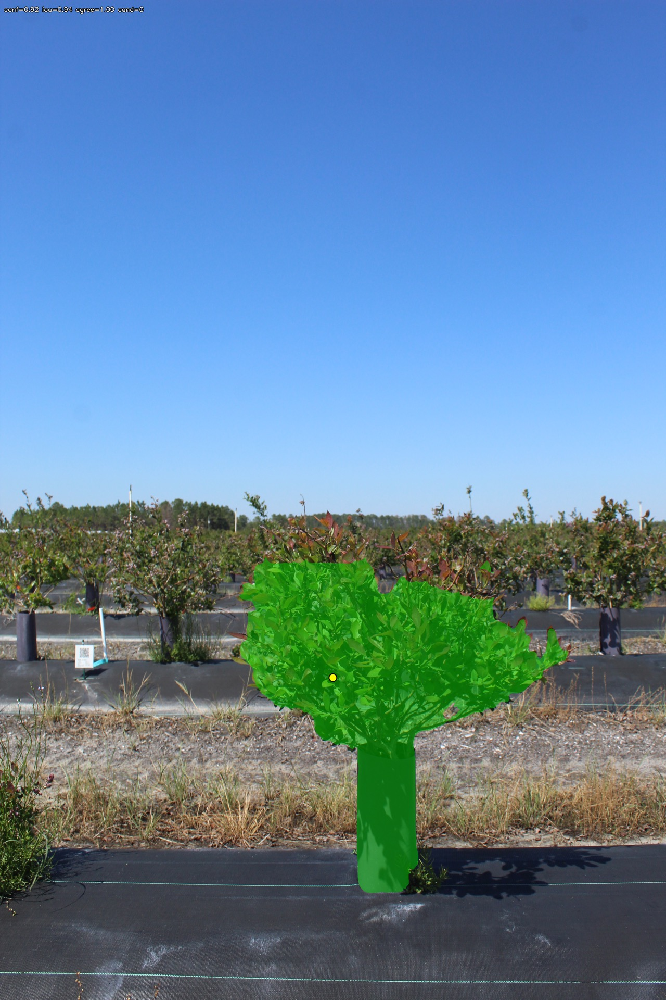 | 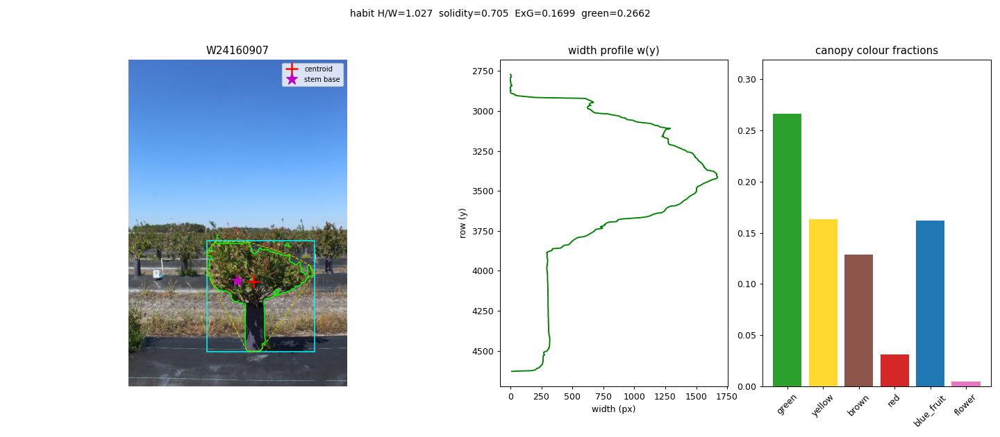 | 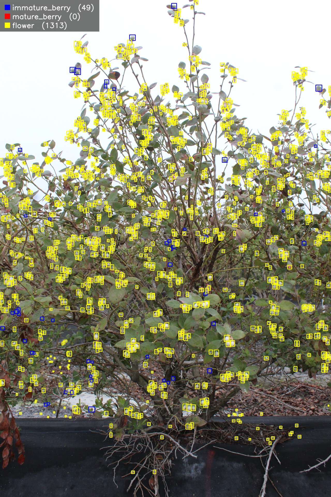 |
| center-plant mask overlay | per-plant trait figure | berry/flower boxes — v3 model (mAP@50 0.835) |

A few more samples live in each stage's `examples/` folder. Full datasets, model weights, and bulk
outputs are kept out of git.

---

**The rest of this README documents Stage 1 (Segmentation) in detail.** The commands below are run
from inside the **`Segmentation/`** folder, where the package is `SAM3_new/` and the venv is
**`../.venv-sam3`**.

> Stage 1 is plant **segmentation only**; berry detection (stage 3) consumes these masks downstream.

## Sample outputs

Green = the segmented center-plant mask. The pipeline keeps the rooted foreground plant and
drops the neighbouring / background bushes.

| | | |
|:--:|:--:|:--:|
| 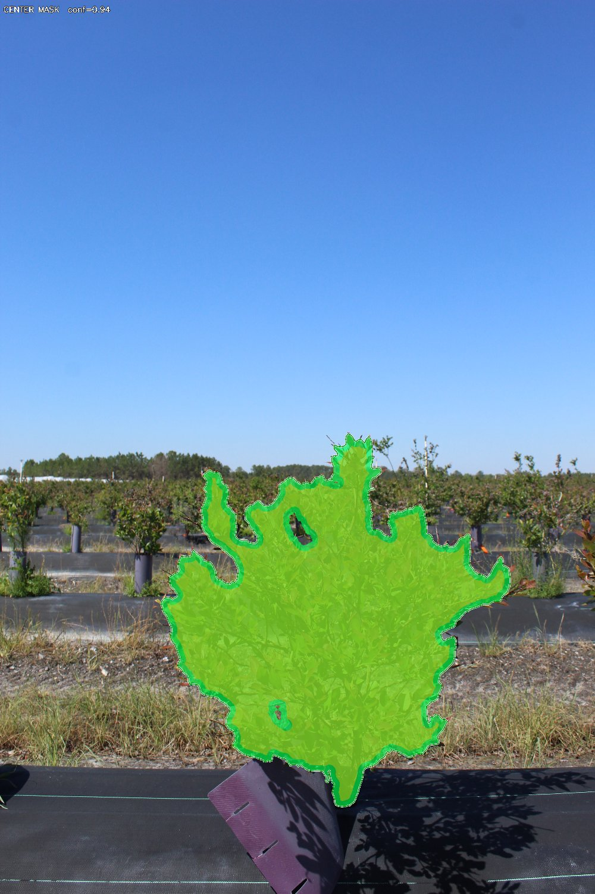<br>`W24160914` · conf 0.94 | 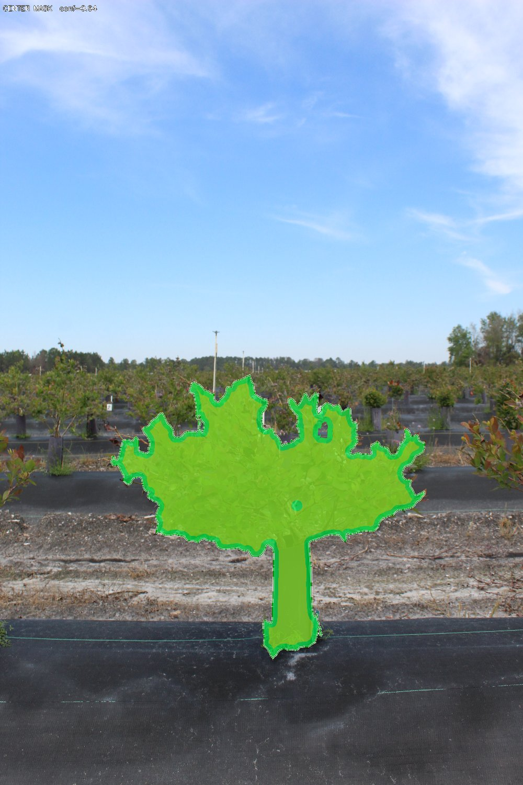<br>`W24120513` · conf 0.94 | 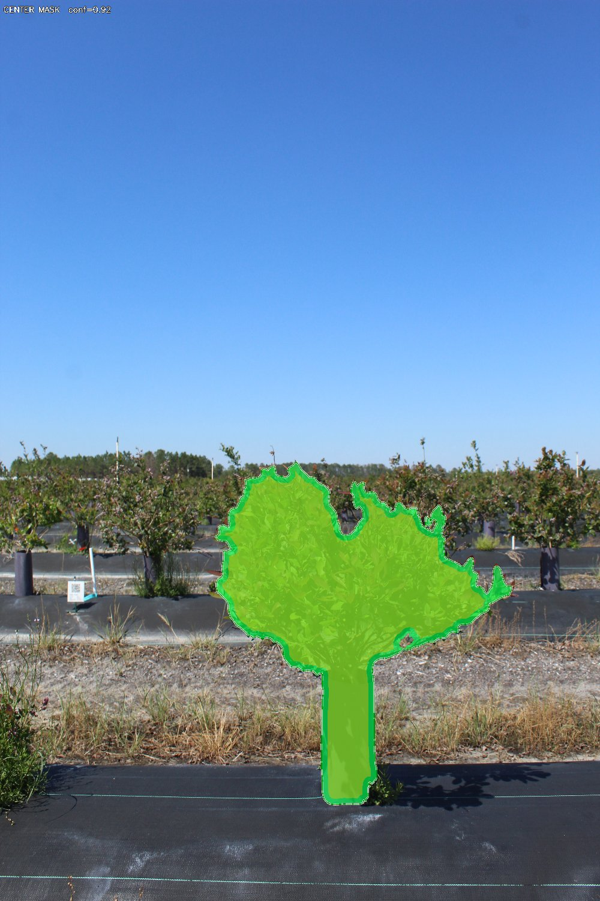<br>`W24160907` · conf 0.92 |
| 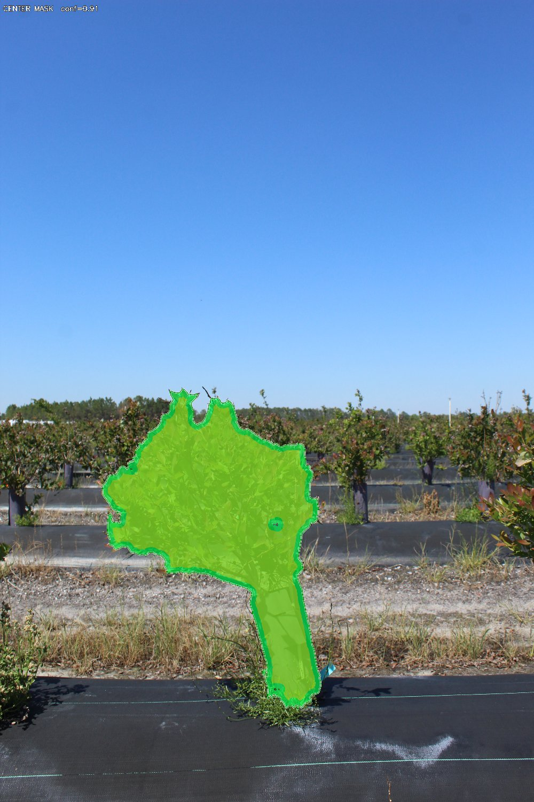<br>`W24160904` · conf 0.91 | 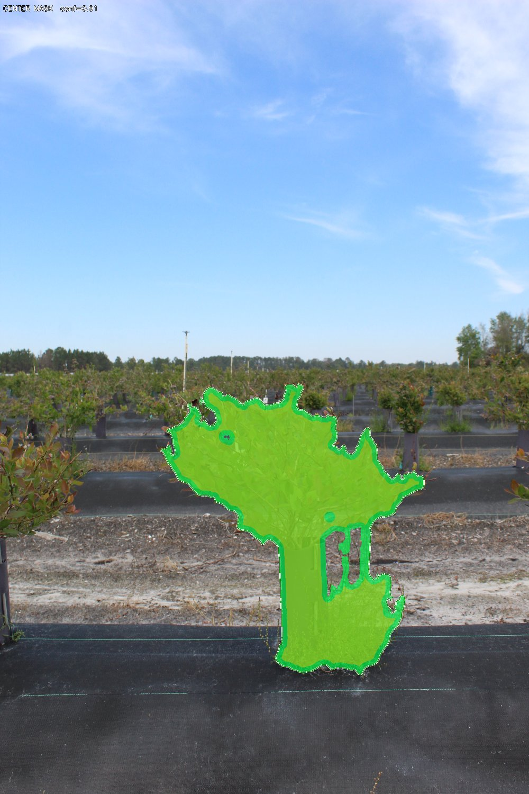<br>`W24120512` · conf 0.91 | 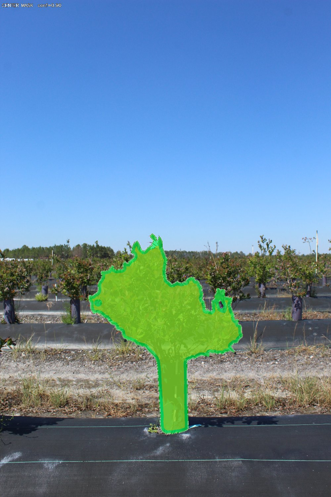<br>`W24160902` · conf 0.90 |
| 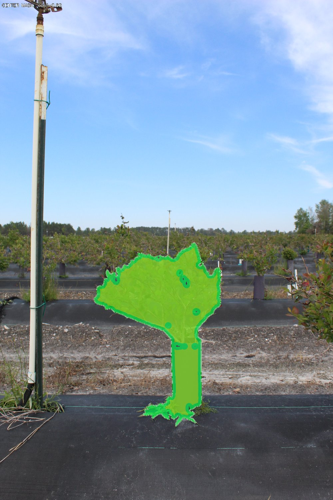<br>`W24120514` · conf 0.90 | 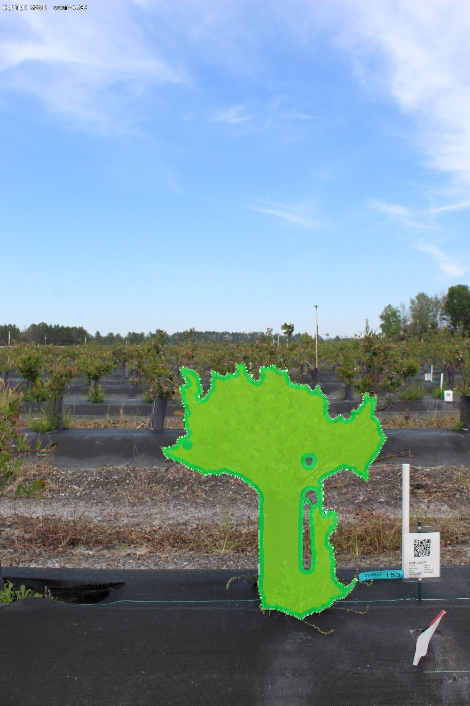<br>`W24120501` · conf 0.90 | 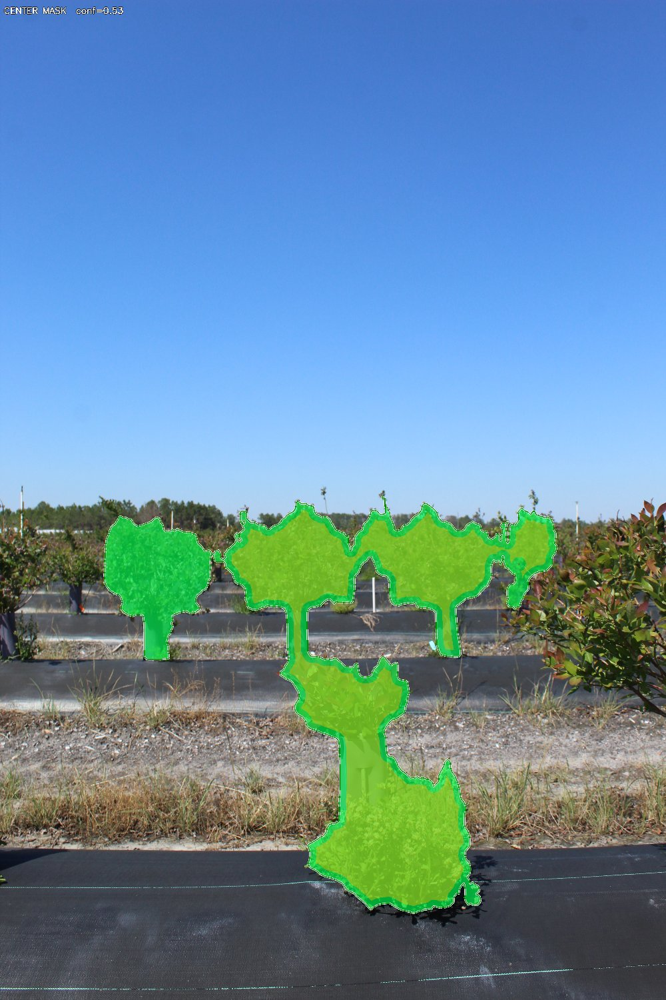<br>`W24160905` · **hard case** ↓ |

On a 41-image evaluation set the pipeline produced a leak-free single-component mask for every
image (mean confidence **0.83**). The last sample (`W24160905`) is the one genuinely hard case —
see [Known limitation](#known-limitation--merged-plants) below.

## How it works

The pipeline lives in [`SAM3_new/`](SAM3_new) and runs as `python -m SAM3_new.cli segment <in> <out>`.

1. **Ingest** (`io_utils`) — enumerate a directory, load EXIF-upright RGB.
2. **Stem anchor** (`stem_anchor`) — an Excess-Green vegetation map → ground-line estimate → a
   **stem seed** placed low in the central canopy (the 70th-percentile row of central vegetation,
   robust to ground weeds). From it: a center-biased **plant box** plus **positive/negative
   geometric prompt boxes** (negatives over the left/right sideline plants) and sky/mulch
   negative points.
3. **Segment** (`segmenter.Sam3HybridSegmenter`) — SAM 3 `set_image`, then an open-vocabulary
   **concept prompt chain** `"blueberry bush"` → `"blueberry plant"` → `"plant"`. Each prompt runs
   `set_text_prompt` + the geometric boxes, area-filters the returned candidates, and **scores**
   them by spatial priors: closeness to image center, whether the stem seed is inside, overlap
   with the plant box, ground contact, plausible size, minus a side-edge penalty. The best
   candidate is chosen; if concept grounding finds nothing, it falls back to a stem-only
   interactive `predict_inst`. The winner is then refined with a two-pass `predict_inst`
   (with guards: reject if the refined mask leaves the seed, drifts out of area bounds, or
   disagrees too much).
4. **Clean** (`mask_ops`) — keep **only the stem-seed-connected component** of the mask. This is
   the key step that removes the disconnected background-plant row (see below), while a
   confident eroded **core** is also computed.
5. **Report** — overlays, mask previews, binary mask PNGs, `masks/*.mask.npy` + metadata,
   neighbour masks, and `segmentation_report.{csv,json}` + `sam3_diagnostics.{csv,json}`.

### Why SAM 3 (and where the masking is cleaned)

SAM 3's concept prompting often returns a *single* "bush" blob that covers the target plant **and**
a disconnected row of background bushes along the horizon. So the decisive cleanup is geometric,
not semantic: the full mask is reduced to **the connected component containing the stem seed**
(`keep_seed_component=True` in `Sam3NewConfig`). Disconnected background blobs vanish; the rooted
center plant is kept whole. The image masks are operated on un-eroded so a sparse, see-through
canopy isn't accidentally split (an optional `seed_component_close_frac` can bridge small gaps).

## Setup

SAM 3 pins `numpy<2`, so it runs in an isolated **Python 3.12** virtual environment.

```bash
# 1. clone SAM 3 and request gated weights (accept the license at
#    https://huggingface.co/facebook/sam3, then `hf auth login` with a token)
git clone https://github.com/facebookresearch/sam3 ../sam3

# 2. isolated venv (numpy<2 has no Python 3.13 wheels)
python3.12 -m venv .venv-sam3
.venv-sam3/bin/pip install "numpy<2" torch torchvision Pillow "opencv-python<4.11" \
    "matplotlib<3.11" einops pycocotools psutil
.venv-sam3/bin/pip install fastapi "uvicorn[standard]"   # for the browser review app
.venv-sam3/bin/pip install -e ../sam3
```

**Apple Silicon / CPU note.** SAM 3 targets CUDA; to run it on a Mac, `../sam3` needs 5 small
patches (a `cv2.distanceTransform` fallback for the Triton EDT kernel; device-aware
`position_encoding`, `decoder`, and `geometry_encoders`; and a bf16→native-dtype fix in
`perflib/fused.py`). The model is also forced to float32 and fed PIL images on non-CUDA devices
(handled in `SAM3_new/segmenter.py`).

## Run

```bash
HF_TOKEN=hf_xxx HF_HUB_DISABLE_XET=1 PYTORCH_ENABLE_MPS_FALLBACK=1 \
  .venv-sam3/bin/python -m SAM3_new.cli segment <input_dir> <output_dir> --device cpu
```

The `facebook/sam3` checkpoint (~3.2 GB) auto-downloads on first run; `HF_HUB_DISABLE_XET=1` is
required (the xet transfer protocol stalls). Validated on Apple Silicon with `--device cpu`.

Useful flags: `--text-prompt`, `--fallback-prompts`, `--sam3-confidence-thresh`,
`--plant-box-width-frac`, `--negative-box-frac`, `--rotate`, `--no-save-neighbor-masks`.

## Outputs

```
<output_dir>/
  overlays/*.overlay.png          # mask + core + seed/box, with a confidence caption
  mask_previews/*.mask_preview.png
  mask_pngs/*.mask.png            # binary mask
  masks/*.mask.npy + *.meta.json  # the mask + metadata (source_path, seed_xy, confidence, ...)
  neighbor_masks/*.npy            # non-selected concept candidates
  segmentation_report.{csv,json}
  sam3_diagnostics.{csv,json}     # prompt_used, candidate_count, scores, fallback_reason
```

## Manual mask cleanup

For the occasional frame the automatic cleanup can't resolve, two editors are included — a
browser app for non-programmers, and a keyboard-driven matplotlib editor. Both operate on the
same persisted masks and save in place, so all downstream use consumes the corrected mask.

### Browser app (recommended — no terminal)

Double-click **`Launch Mask Review.command`** in Finder. It starts a small local server and opens
the review page in your browser automatically (nothing leaves the machine — it binds to
`127.0.0.1` only). To run it by hand, or to review a specific output folder:

```bash
.venv-sam3/bin/python -m SAM3_new.review_app <output_dir>   # e.g. output_Testimages
```

A sidebar lists every image with a status dot (🟢 saved / 🔴 not yet reviewed) and a thumbnail.
Pick an image, then **remove, add, or complete** the mask:

- **Click-delete** (default) — click a stray green blob to remove that connected component.
- **Erase** brush — drag over a background plant that is *merged* into the center plant (size
  slider, or `[` / `]`).
- **Add** brush — drag to *paint* mask onto a region the pipeline missed (the inverse of Erase).
- **Smart-add** — click (or drag a box on) a missed region and **SAM 3 segments it** and unions it
  into the mask. The model loads **lazily on first use only**, so erase/paint stay fast and
  model-free; the first click also builds the model (a few seconds on CPU, instant on a GPU box).
- **Keep seed** keeps only the stem plant; **Snap-separate** severs thin bridges; **Fill holes**
  closes interior gaps.
- **Zoom & pan** (`+` / `−` / Fit, ⌘/Ctrl-scroll or trackpad pinch; two-finger / middle-drag to pan)
  for pixel-precise work; an **opacity** slider and hold-**Space** to **peek** the photo underneath.
- **Undo** / **Reset**, then **Save**. **Next** moves on.

**Save replaces the originals in place.** It overwrites `masks/<stem>.mask.npy` and regenerates the
pipeline's derived images for that image — `overlays/<stem>.overlay.png`,
`mask_previews/<stem>.mask_preview.png` and `mask_pngs/<stem>.mask.png` — from the corrected mask,
using the same renderers as the pipeline. The output looks exactly as if the pipeline had produced
the corrected mask; no separate copy is kept. (It overwrites in place — there is no backup of the
pre-edit mask, so the in-session Undo/Reset are your safety net before Save.)

Keyboard shortcuts mirror the buttons: `c` click-delete, `e` erase, `a` add, `g` smart-add;
`k` keep-seed, `o` snap-separate, `f` fill-holes; `[` / `]` brush size; `+` / `−` / `0` zoom;
hold `Space` to peek; `u` undo, `r` reset, `s` save, `n` next.

By default smart-add runs SAM on the CPU; pass `--device cuda` (or `mps`) to
`SAM3_new.review_app` on a machine with a GPU for near-instant adds.

### Matplotlib editor (terminal)

```bash
.venv-sam3/bin/python -m SAM3_new.mask_review <output_dir> [--stem W24160905]
```

It shows the image with the mask overlaid. **Click** a blob to delete that connected component;
press **`b`** for a **brush** and drag to erase (for background plants *merged* into the center
plant); `[` / `]` size the brush; `o` snap-separates thinly-connected blobs; `k` keeps only the
stem-seed blob; `u` undo, `r` reset, `s` save (overwrites the mask in place), `n` next, `q` quit.

## Known limitation — merged plants

The automatic cleanup removes background plants that are **disconnected** from the target. When a
background bush physically **touches** the center plant's canopy at the horizon (as in the
`W24160905` sample), the mask is a single connected component and no purely-geometric rule can
separate them — that is an inherent 2D ambiguity. These rare cases are flagged by lower confidence
and are cleaned with the brush tool above.

## Next step (separate)

Train a berry detector (e.g. YOLO on annotated blueberries) and run it **inside** these
center-plant masks to count per-plant berries. That detection step is deliberately out of scope
for this segmentation repo.
