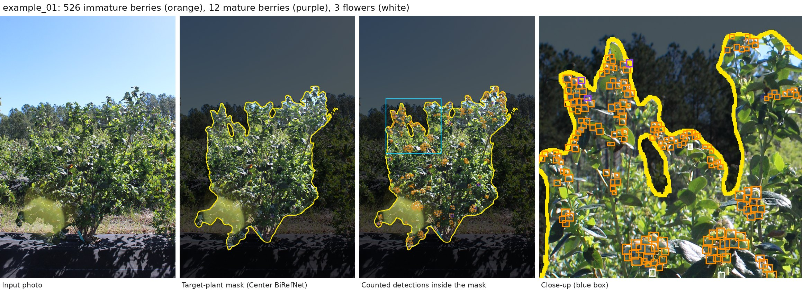
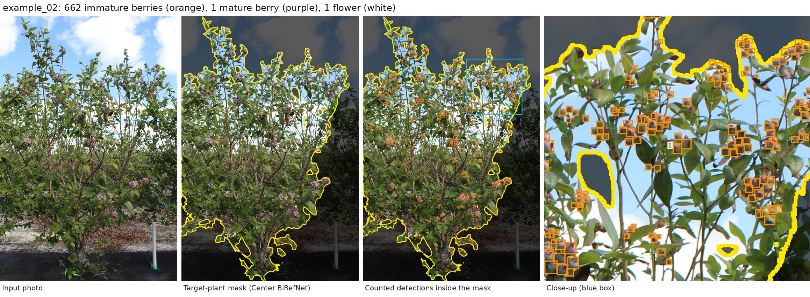
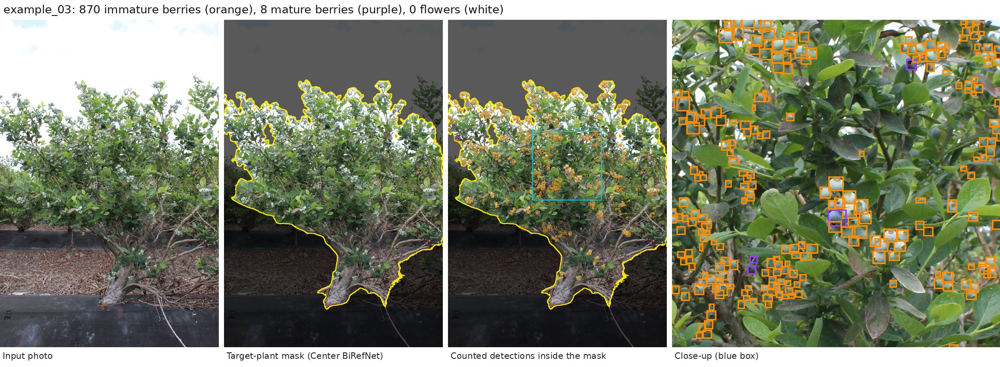
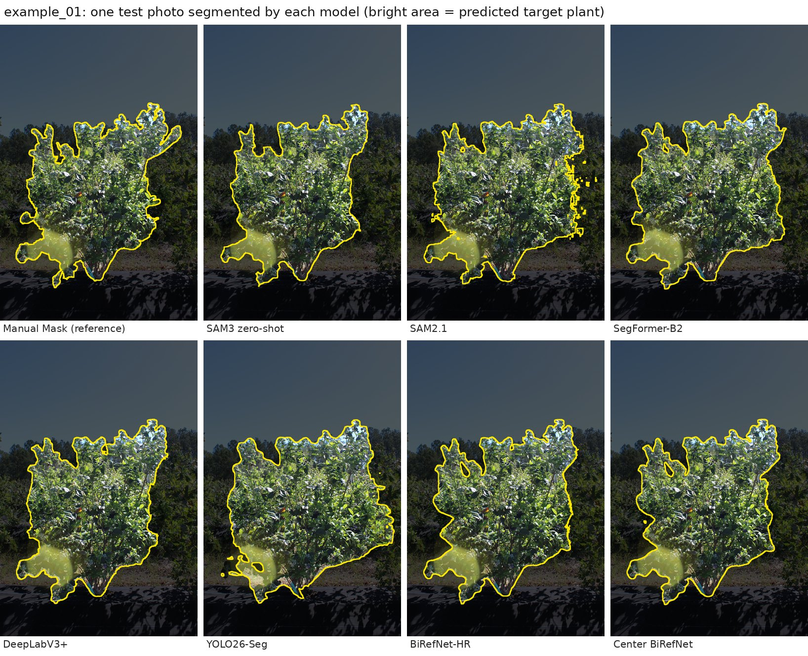

# Examples

Outputs of the workflow on photos from the segmentation test set. The photos are rover images of three plants of
different ages; they were renamed `example_01` to `example_03` and are shown downscaled.

## Pipeline output

`pipeline_example_01.jpg` to `pipeline_example_03.jpg` were made with [`../pipeline/run.py`](../pipeline/run.py)
and the weights listed in the main README. Each figure has four panels:

1. the input photo;
2. the Center BiRefNet target-plant mask (outside the mask is darkened, the yellow line is the mask boundary);
3. the detections that are counted: confidence of at least 0.35 and box centre inside the mask
   (orange immature berry, purple mature berry, white flower);
4. a full-resolution close-up of the area in the blue box.

`outputs/` holds the two per-photo tables of the same run, with the file-path columns removed:

- `detections_per_image.csv`: counted immature berries (`unripe`), mature berries (`ripe`), flowers, and the mask
  size;
- `architecture_per_image.csv`: the image-derived traits described in [`../traits/README.md`](../traits/README.md).

## Segmentation models

`segmentation_models_example_01.jpg` shows the test-set masks of every segmentation condition for the plant in
`example_01`: the Manual Mask, the SAM3 zero-shot mask, and the six trained models. The masks come from the test
evaluation in [`../segmentation/benchmark`](../segmentation/benchmark).

